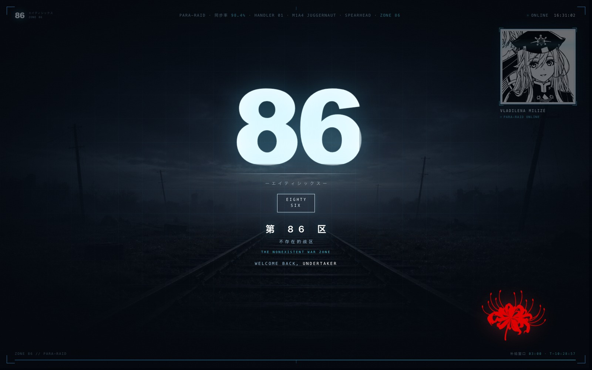
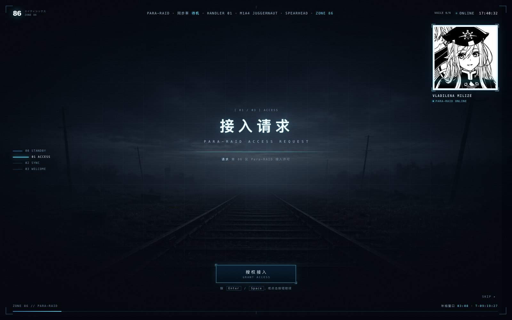
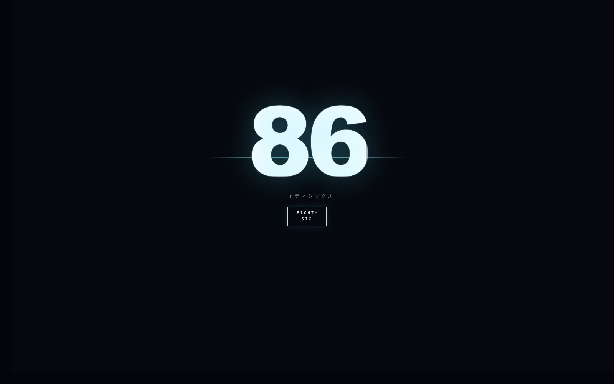
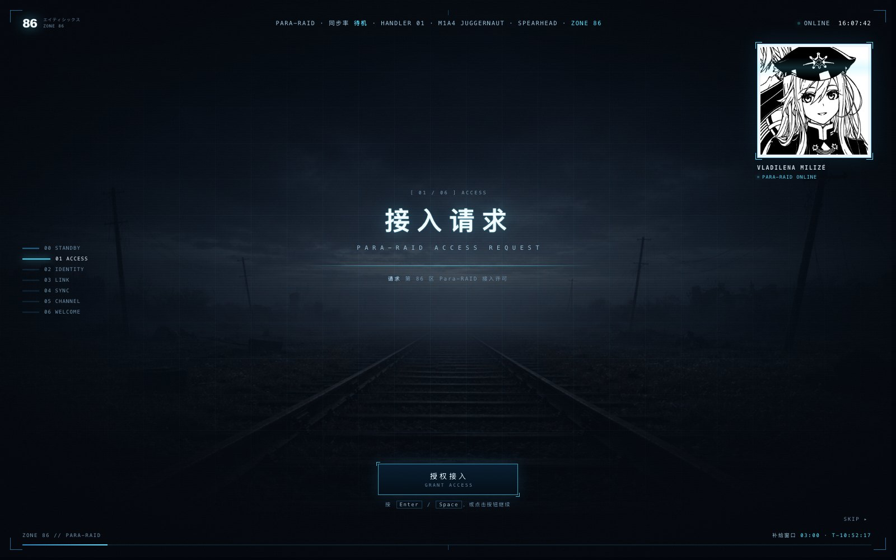
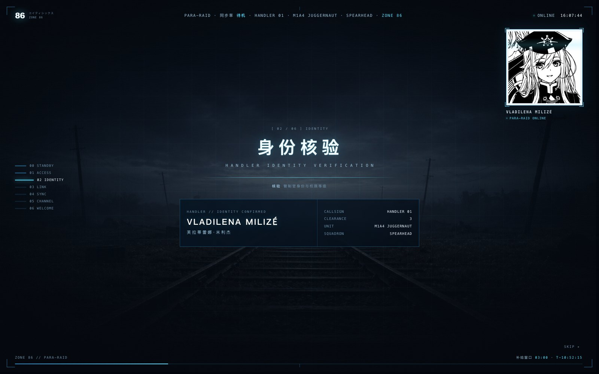
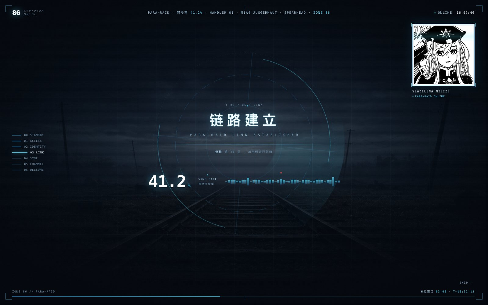
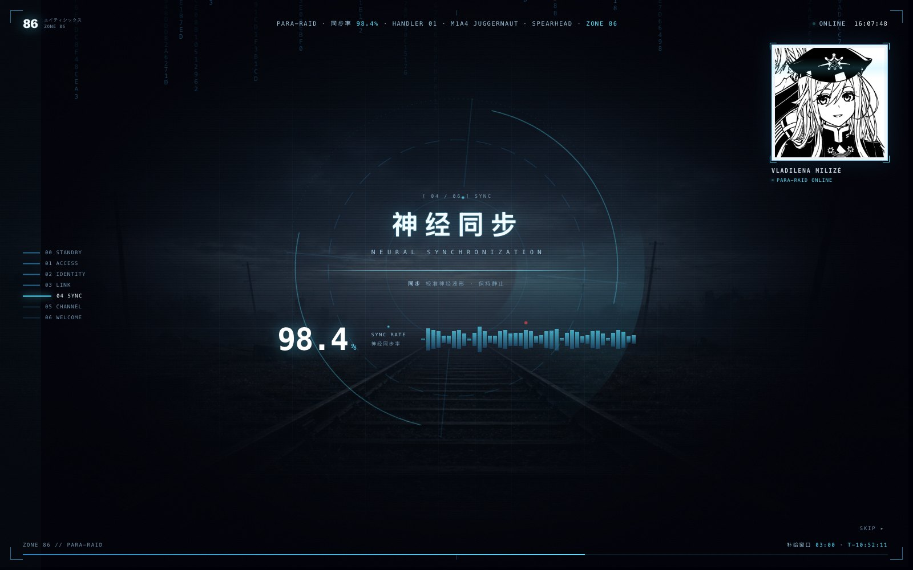
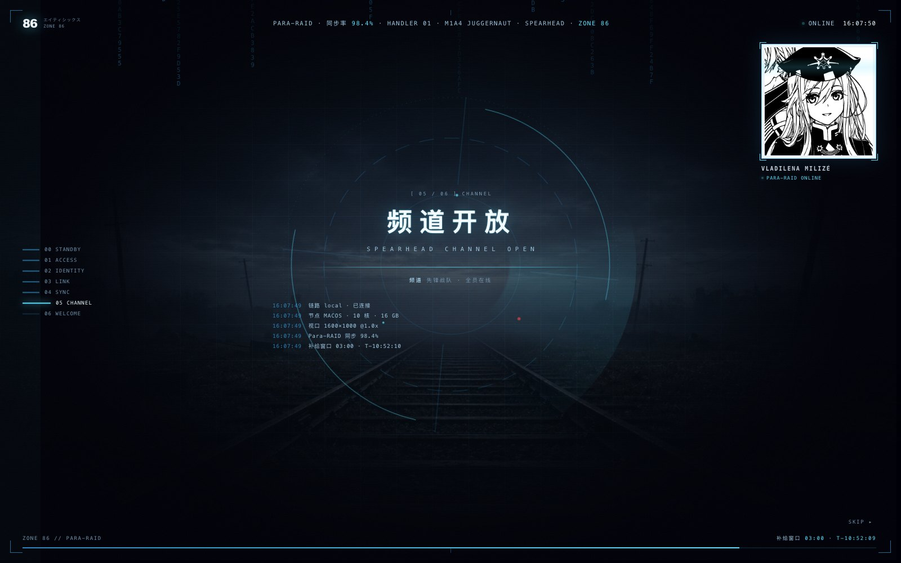
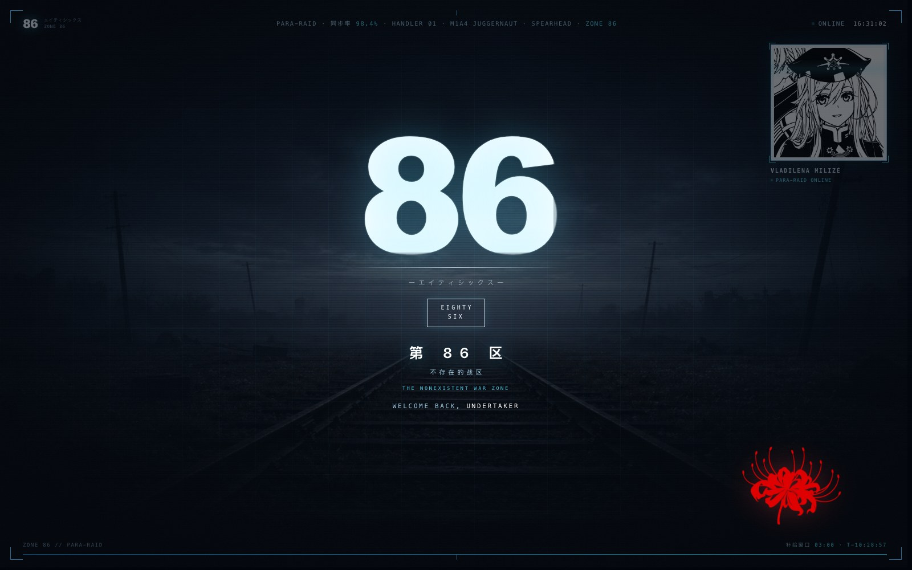

# 86 -不存在的战区- · DSH 开机动画

[github.com/JonathanChang-alt/dsh-86-startup](https://github.com/JonathanChang-alt/dsh-86-startup)

冷启动时先接管首屏：黑幕里的 **86** 锁标 → 过曝洗白 → 第 86 区战术底板 →
Para-RAID 接入序列（短版三步 / 长版六幕）→ 彼岸花终幕，然后揭开幕布进入主界面。

它和「第 86 区」皮肤（[dsh-86-zone-ui](https://github.com/JonathanChang-alt/dsh-86-zone-ui)）共用同一套配色、
字体、HUD 肖像和背景图：动画最后一帧的右上角 HUD，正好落在皮肤主界面
右上角同一个位置，接续感是刻意做的。



## 它是什么

不是一张会动的壁纸，也不是纯 CSS 换色。它在 React 应用挂载**之前**就拿到
首屏，播完一整段 86 风格的接入序列，再把页面交还给 DSH。

- **不是播片**：每一步的状态字、ID 卡、同步率、事件流都是运行时生成的。
- **可以停**：第 1 步「接入请求」会等你按 `Enter` / `Space` 或点按钮；
  长版第 2 步「身份核验」也可以停；也可以在设置里改成一路自动。
- **可以跳过**：右上角 `SKIP ▸`，`Esc` 同样有效（可关）。
- **不会锁死**：任何一步异常都有 12 秒兜底，最坏情况也会把主界面还给你。

## 六幕（短版只留 1/4/6）

| # | 中文主字 | 英文副标题 | 画面 | 是否等待 | 短版 |
|---|---|---|---|---|---|
| 1 | 接入请求 | `PARA-RAID ACCESS REQUEST` | 86 锁标退场，战术底板亮起 | 看「自动播放」 | ✅ |
| 2 | 身份核验 | `HANDLER IDENTITY VERIFICATION` | 管制官 ID 卡：呼号 / 权限 / 机体 / 战队 | 看「自动播放」 | — |
| 3 | 链路建立 | `PARA-RAID LINK ESTABLISHED` | 环形雷达出现，同步率 00.0 → 41.2% | 自动 | — |
| 4 | 神经同步 | `NEURAL SYNCHRONIZATION` | 大读数 98.4%、42 根波形、Hex 数据雨 | 自动 | ✅ |
| 5 | 频道开放 | `SPEARHEAD CHANNEL OPEN` | 真实启动事件流：链路 / 节点 / 视口 / 补给 | 自动 | — |
| 6 | 欢迎回来 | `WELCOME BACK, UNDERTAKER` | 状态收束，过渡到终幕 | 自动 | ✅ |
| 终 | 第 86 区 | `THE NONEXISTENT WAR ZONE` | 86 锁标 + 彼岸花 + 色散故障揭幕 | 自动 | ✅ |

### 时长版本

- **短版（默认，约 19 秒）**：只保留 **1 接入 / 4 神经同步 / 6 欢迎回来**；2 身份、3 链路、5 频道三幕整段删除；片头与终幕减半；短版只播 1/4/6 三句配音。
- **长版（约 37 秒）**：六幕全留、六句配音全播，就是原来的完整版。
- 设置页「时长版本」可随时切换；长版原样保留，不会丢内容。



## 视觉

| 元素 | 说明 |
|---|---|
| 86 锁标 | 超大 `86` 字，白→青的渐变扫光；下方细线、`ーエイティシックスー`、`EIGHTY / SIX` 框。入场是缩放淡入，终幕会再做一次 |
| 战术底板 | 铁轨夜景（或花海 / 纯黑）压暗做底，叠技术网格、扫描线、暗角、胶片颗粒 |
| 右上 HUD | 蕾娜线稿压在白色 ID 卡上，四角青色框 + 扫描光带 + `VLADILENA MILIZÉ / PARA-RAID ONLINE` |
| 左列阶段柱 | `00 STANDBY` → `06 WELCOME` 七格，走过的压暗、当前的拉长点亮 |
| 环形雷达 | SVG 双环 + 旋转扫描扇面 + 三颗错相光点；第 3 步起出现 |
| Hex 数据雨 | canvas 低帧率（约 13fps），中心径向留空，窗口不可见时停 |
| 彼岸花 | 终幕右下角的红，`#e2413f`，全界面唯一的红 |
| 顶部与底部 | 实时时钟、`补给窗口 03:00 · T-05:23:11` 倒计时、进度条 |
| 真实数据 | 事件流里是本机真实信息：`location.host`、CPU 核数、`deviceMemory`、视口、DPR、时区时间；没有编造的假指标 |

## 蕾娜 AI 配音

不是系统 TTS。六句台词是用你在《86 蕾娜 WOTB 语音包》里训练的那套 **蕾娜主模型** 重新生成的：

| 项 | 值 |
|---|---|
| 模型 | GPT-SoVITS **v2ProPlus** |
| GPT 权重 | `lena-e8.ckpt` |
| SoVITS 权重 | `lena_e8_s360.pth` |
| 参考音频 | `我的二创/lena voice 1.wav`（`パラレイド アクティベート。ハンドラー1より…`） |
| 语言 | 日语（角色本音；界面文字仍是中/英） |
| 总时长 | 6 句约 **26.4 秒** |

每句按 4 个种子生成，用 faster-whisper 日语 ASR 做字符重叠校验，取内容最完整的一条；
只保留 **clean 母带**（模型直接输出 + 响度/限幅），以前生成的 Para-RAID 轻/中已删除。

> **短版只播 1/4/6 三句**（接入 / 神经同步 / 欢迎）；长版六句全播。六条音频都保留，切换版本不会丢。

先听再决定：**[蕾娜 AI 配音试听页](docs/voice-audition.html)**（直接双击打开，不依赖 DSH）。
试听页里每句只有原始音一个播放器；ASR 报告在 [docs/voice-report.json](docs/voice-report.json)。

> 运行时音频（base64 **PCM WAV**）和 manifest 都直接内嵌在 `lib/splash.js`（约 2.2MB）。
> Electron 的 selfBoot 路径不经过 Host 的 `tapIndex`，拿不到 `window.__DSH_86_STARTUP_VOICE__`，
> 所以 manifest 也必须跟着 splash 走；这样不再需要单独的 manifest / voice-data 请求。
> 播放优先 `<audio>` 的 data URI，WebAudio `decodeAudioData` 兜底。MP3 只留给试听页和 `/audio` 兜底。

> 第 4 句「神経同期、九十八・四パーセント。同調、完了。」的 ASR 重叠率只有 57%，但选中的 seed 7 实际把两句都念全了，只是 ASR 把「パーセント」听成了「%」；请以试听为准。
> 第 6 句已按要求改为「おかえりなさい、アンダーテイカー。……ずっと、待っていました。」／「欢迎回来，undertaker。……我一直，在等你。」；
> 身份/呼号仍是 `HANDLER 01`，只有第 6 步与终幕的欢迎称呼改成 undertaker（设置页「终幕称呼」可改）。
> 如果哪句听感不对，改 `tools/generate_voice.py` 里的 `LINES`，换种子/改文案后重跑即可。

**时长**（点击授权后，不含你点按钮前的等待）：

- 短版约 **19 秒**（含点击约 21 秒）；长版约 **37 秒**（含点击约 39 秒）。
- 速度 1.35×：短版约 16 秒，长版约 30 秒。
- 关掉「语音播报」：短版约 9 秒，长版约 21 秒。

### 重新生成（可选 / 开发者）

仓库里已经带了生成好的 6 句 clean 音频，**普通使用不需要重跑**。  
只有你想换模型、换参考音或改台词时才需要本地 GPT-SoVITS 环境；模型和参考音频**不随仓库分发**。

```bash
export GPT_SOVITS_TOOLCHAIN=/path/to/GPT-SoVITS-toolchain
export LENA_MODEL_DIR=/path/to/lena-model
export LENA_REF_AUDIO=/path/to/lena-reference.wav

# 1) 生成 6 句（4 个种子 + ASR 校验，CPU 约 2–3 分钟）
"$GPT_SOVITS_TOOLCHAIN/venv/bin/python" tools/generate_voice.py \
  --seeds 123,1,7,42 --out /tmp/lena_boot

# 2) 做 clean master、写 manifest、生成试听页，并把数据嵌进 splash.js
python3 tools/build_voice_assets.py
```

`build_voice_assets.py` 会写一个 `assets/voice/voice-data.js` 中间文件（已 gitignore），
最终运行时数据在 `lib/splash.js` 里。

## 安装

三个步骤，**第 3 步是关键**，漏了不会生效。

### macOS / Linux

```bash
# 1. 克隆到一个不会被 DSH 升级覆盖的目录
git clone https://github.com/JonathanChang-alt/dsh-86-startup.git
cd dsh-86-startup

# 2. 一条命令装进 desktop profile：
#    pnpm add link:<repo> + 把 dsh-86-startup 加进 dsh.profile.bundles
./install.sh

# 或者手动：
# cd ~/.dsh/profiles/desktop
# pnpm add link:/absolute/path/to/dsh-86-startup
# 然后编辑该目录的 package.json，把 "dsh-86-startup" 加进 dsh.profile.bundles
```

```json
"dsh": {
  "profile": {
    "bundles": [
      "@deepseek-ai/dsh-base",
      "@deepseek-ai/dsh-web-app",
      "dsh-86-zone-ui",
      "dsh-86-startup"
    ]
  }
}
```

然后**完全退出 DeepSeek Harness**，再打开。

> ### 和 dsh-startup-secret 只能留一个
>
> 两个插件都会往首屏注入黑幕。本插件检测到 `dsh-startup-secret` 仍启用时
> 会主动让位（不会叠两层），但那样你看到的还是红色开机动画。
> 想用第 86 区这套，请把它从 `dsh.profile.bundles` 里移出（依赖可以留着），
> 或者先到它的设置页里关掉。想切回红色那套：把 `dsh-86-startup` 移出
> bundles、把 `dsh-startup-secret` 加回去，再重启。

### Windows

前置：Windows 10/11、DSH 桌面版、Node 22+、pnpm（`npm install -g pnpm`，或使用 DSH 自带的 pnpm）。

```powershell
git clone https://github.com/JonathanChang-alt/dsh-86-startup.git "$env:USERPROFILE\Documents\dsh-86-startup"
cd "$env:USERPROFILE\Documents\dsh-86-startup"
powershell -ExecutionPolicy Bypass -File .\install.ps1

# web profile:
# powershell -ExecutionPolicy Bypass -File .\install.ps1 -Profile web
```

`install.ps1` 会备份 profile、执行 `pnpm add "link:C:/..."`、把 `dsh-86-startup` 加进 `dsh.profile.bundles`，并用 Node 写入**无 BOM** 的 JSON。

手动安装：

```powershell
$plugin  = "$env:USERPROFILE\Documents\dsh-86-startup"
$profile = "$env:USERPROFILE\.dsh\profiles\desktop"

cd $profile
pnpm add "link:$($plugin -replace '\\','/')"
# 然后用 VS Code 打开 $profile\package.json，把 "dsh-86-startup" 加进 dsh.profile.bundles
```

- 如果 DSH 的 home 不是 `%USERPROFILE%\.dsh`，先设置 `$env:DSH_HOME = "D:\dsh"`，`install.ps1` 会优先读它。
- **不要用 PowerShell 5.1 的 `Set-Content -Encoding UTF8` 手写 JSON**：它会写 UTF-8 BOM，DSH 的 `JSON.parse` 不接受，profile 会起不来。用 `install.ps1`、VS Code 或 Node 改。
- 插件本身是**纯 Web/Node**，同一份代码在 Windows 和 macOS 上跑；没有 mac 专用依赖，语音是内嵌 WAV，Windows 的 Electron 不需要额外编解码器。
- 改完**完全退出 DeepSeek Harness，再打开**；只关窗口不生效。

## 设置

装好后进入 **设置 →「启动动画 · 第 86 区」**。

| 分组 | 选项 | 默认 |
|---|---|---|
| 播放 | 启用 | 开 |
| | 时长版本 | 短版 · 约 19 秒 / 长版 · 约 37 秒 |
| | 显示模式 | 每次会话 |
| | 自动播放 | 点击一次进入 |
| | 速度 | 1×（0.35–3×；AI 配音最多 1.35×） |
| | 允许跳过 | 开 |
| 声音 | 界面音效 | 开（WebAudio 现场合成，无音频文件） |
| | 音效音量 | 45% |
| | 语音播报 | 开（蕾娜 AI 配音，日语，原始音） |
| | 语音音量 | 80% |
| 身份 | 呼号 / HANDLER | `HANDLER 01` |
| | 权限等级 | `3` |
| | 管制官姓名（英 / 中） | `VLADILENA MILIZÉ` / `芙拉蒂蕾娜·米利杰` |
| | 终幕称呼 | `undertaker`（第 6 步与终幕的欢迎语） |
| | 机体型号 / 战队 | `M1A4 JUGGERNAUT` / `SPEARHEAD` |
| 画面 | 背景场景 | 铁轨 / 花海 / 纯黑 |
| | 右上 HUD 肖像 | 5 张（原图 / 素颜 / 特写 / 军帽 / 侧光），可关 |
| | Hex 数据雨 / 技术网格 | 开 / 开 |
| 文案 | 终幕标题 / 副标题 / 英文 / 页脚 | `第 86 区` / `不存在的战区` / `THE NONEXISTENT WAR ZONE` / `ZONE 86 // PARA-RAID` |

「立即预览」会先保存，再清掉本轮的已播标记并刷新页面。

## 截图

| 锁标 | 接入 |
|---|---|
|  |  |

| 身份核验 | 链路建立 |
|---|---|
|  |  |

| 神经同步 | 频道开放 |
|---|---|
|  |  |



## 本地预览

`preview/index.html` 是一个完全离线的预览页，不依赖 DSH，也不碰真实配置：

```bash
# macOS
open preview/index.html

# Windows
start preview\index.html
```

- 左下角控制台可以改自动播放、时长版本、语音、速度、肖像、场景、HUD / 数据雨 / 网格，改完自动刷新。
- `?snap=1..7&ui=0` 会直接停在某一幕（1 锁标、2 接入、3 身份、4 链路、5 同步、6 频道、7 终幕），
  用来截图或对照设计稿；`ui=0` 顺便隐藏控制台。
- `?auto=full|once|off` 覆盖自动播放，`&portrait=3&scene=rail` 覆盖画面；
  左下角新增「时长版本」和「AI 语音」开关，短/长版和配音都可以现场切。
- 只想听配音：打开 [docs/voice-audition.html](docs/voice-audition.html)。

预览页读取的是 `../assets/`，和插件运行时用的是同一批图。

## 目录

```
dsh-86-startup/
├── lib/
│   ├── index.js     Host：注入首屏 + 5 个路由 + 配置持久化
│   ├── splash.js    浏览器端：六幕时间线、雷达、数据雨、音效、语音
│   ├── splash.css   全部样式（e86b- 前缀）
│   └── client.js    设置页「启动动画 · 第 86 区」+ 桌面端自举
├── assets/          背景 / 肖像 / 彼岸花（来自第 86 区皮肤）
│   └── voice/       6 句 clean MP3（试听）+ manifest（运行时数据在 splash.js 内）
├── tools/           generate_voice.py / build_voice_assets.py（本机模型生成用）
├── preview/         离线预览页 + 控制台（含 AI 语音 / 音效开关）
├── docs/            README 截图 + voice-audition.html + voice-report.json
├── test/
│   ├── host.mjs     Host 侧冒烟（路由 / 配置 / 让位 / 路径穿越）
│   └── shoot.mjs    CDP 截图工具（真实时间，非 virtual-time）
├── install.sh        macOS / Linux 安装脚本
├── install.ps1       Windows PowerShell 安装脚本
├── cordis.patch.yml
├── LICENSE
└── package.json
```

## 工作方式

1. **Host 半侧**（`lib/index.js`）在 `webServer.tapIndex` 里把
   `#dsh-86-startup-root`、关键 CSS、配置和 `splash.js` 塞进 `index.html` 的
   `<head>` / `<body>` 最前面，并注册：
   - `/dsh-86-startup/splash.css`
   - `/dsh-86-startup/splash.js`
   - `/dsh-86-startup/asset?name=...`（白名单：背景 ×2、肖像 ×5、彼岸花）
   - `/dsh-86-startup/audio?name=...`（白名单：`voice-1..6-clean`，兜底）
   - `/dsh-86-startup/config`（GET / POST，写到 `~/.dsh/dsh-86-startup.json`）
2. **首屏兜底**：内联脚本先决定这次播不播（`session` / `daily` / `always`），
   播就锁滚动并盖黑幕；12 秒内动画没接管就自动放行。
3. **浏览器半侧**（`splash.js`）拿 `window.__DSH_86_STARTUP__` 建 DOM，按
   `speed` 缩放整条时间线，结束后写会话标记、解滚动锁、移除根节点。
   `splash.js` 内嵌 manifest + base64 WAV，优先走 `<audio>` data URI，
   WebAudio 解码兜底；每一步等音频播完再加 620ms 收尾；失败时静音，不退回系统 TTS。
4. **设置页**（`client.js`）走 HTTP API，不依赖 `dsh-settings` 的命名空间；
   桌面端若用 `file://` + IPC 下发前端、Host 注入不生效，它会自己拉
   `splash.css/js` 自举。

### 稳健性

- 动画异常 → `catch` 后直接揭幕。
- 12 秒兜底定时器，任何资源 404 / 脚本语法错都不会黑屏锁死。
- 检测到 `#dsh-startup-root`（另一款开机动画）→ 主动让位。
- `prefers-reduced-motion: reduce` → 关掉循环动画，只保留淡入淡出。
- 会话标记：`sessionStorage['dsh-86-startup:shown']`；每日标记：
  `localStorage['dsh-86-startup:day']`。

## 卸载

**macOS / Linux**

```bash
cd ~/.dsh/profiles/desktop
pnpm remove dsh-86-startup
# 再从 package.json 的 dsh.profile.bundles 里删掉 "dsh-86-startup"
```

**Windows**

```powershell
cd "$env:USERPROFILE\.dsh\profiles\desktop"
pnpm remove dsh-86-startup
# 再从 package.json 的 dsh.profile.bundles 里删掉 "dsh-86-startup"
```

配置文件 `~/.dsh/dsh-86-startup.json` 可以留着，下次装回来还在。

## 版权与致谢

- **86 -不存在的战区-** 及其角色、机体、标识归 安里アサト / KADOKAWA /
  A-1 Pictures 所有。本项目是非商业的个人主题，仅用于本机学习与自用；
  如有侵权请联系移除。
- 线稿肖像、铁轨 / 花海背景、彼岸花来自作者自己的
  [dsh-86-zone-ui](https://github.com/JonathanChang-alt/dsh-86-zone-ui) 皮肤，不是从动画里截的帧。
- 蕾娜 AI 配音来自作者本机的 GPT-SoVITS 微调模型（`lena-e8.ckpt` +
  `lena_e8_s360.pth`，参考音频 `lena voice 1.wav`），与 WOTB 语音包同一套；
  插件只分发生成后的音频，不包含模型权重和训练素材。
- 开机序列的结构（首屏注入、Host 路由、设置页自举、兜底放行）参考了
  [huzhengcai471-crypto/dsh-startup-secret](https://github.com/huzhengcai471-crypto/dsh-startup-secret)，
  在此致谢；本项目的画面、文案、时间线和 86 视觉都是重做的。
- 代码 MIT。
